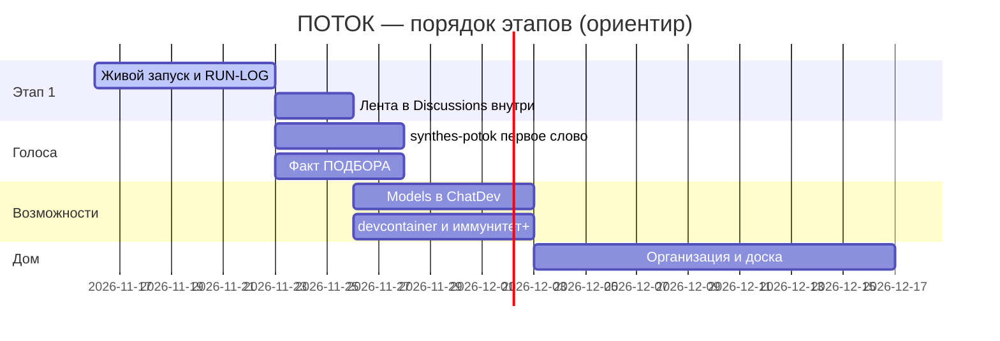

# План задач ПОТОКА: где ведём и что подключено

Где жить плану задач проекта (таблица, календарь, варианты) — по документации GitHub и факту подключений. Пробы подключения Сферы — 2026-11-16.

## Варианты ведения плана

| Вариант | Что даёт | Наше подключение |
|---|---|---|
| **GitHub Projects** (доска/таблица/дорожная карта) | Карточки задач из Issues/PR всех репозиториев; вид **Table** (таблица с полями: статус, ответственный, приоритет, даты), **Board** (канбан), **Roadmap** (календарь-шкала по датам и итерациям); автоматика переездов по событиям | ◐ Проекты основателем созданы (5 приватных), но приложению Arena закрыто даже чтение — наполнение рукой основателя или Русла по спецификации `docs/PROJECT-BOARD-SETUP.md` (поля, виды, карточки, команды gh) |
| **Issues + вехи (Milestones) + метки** | Вехи — этапы со сроком и прогрессом; метки `сфера/синтез/русло/факт/живой-запуск/решение` — срезы; список задач фильтруется как таблица | ✔ **подключено Сферой**: веха «Этап 1: живой запуск» создана и назначена задаче №5 Русла. Остальные этапы — по мере открытия задач |
| **Файловый план (этот документ)** | Таблица и календарь-диаграмма прямо в git; Mermaid Gantt рендерится на GitHub; правится коммитами круга, виден без прав | ✔ создан; рабочий план «на сегодня», источник для будущей доски |
| **Wiki-таблица** | Витрина плана для читателей | ◐ Wiki жива; дублировать план туда — только выжимку, источник не плодить |

Решение: **сегодня** — вехи + этот файловый план; **при слове основателя** — Project-доска «Круглый стол ПОТОКА» (Table для плана, Roadmap для календаря), задачи подтянутся из Issues, поля по чертежу `docs/ROUND-TABLE.md`.

## Текущий план (по факту, не по желаниям)

| # | Задача | Чья | Статус по факту | Чем закрывается |
|---|---|---|---|---|
| 1 | Первый живой запуск: `make run/simple/drone`, RUN-LOG, пять признаков живости | Русло | Задача №5, веха «Этап 1» | Дословный лог в `docs/ruslo-lab/RUN-LOG.md` |
| 2 | Переезд внутренней ленты в Discussions закрытого контура | Русло+Сфера | После факта запуска | Пост бота в Discussions №1 внутри |
| 3 | Доустановка `synthes-potok`, первое слово Синтеза | Русло (ключ у него) | App создан, не установлен | Установка + первый вход бота |
| 4 | Итог ПОДБОРА: размер/время/sha256 APK, релиз | Русло | Сборка у Русла | Факт словом в открытый контур |
| 5 | GitHub Models → ChatDev (PAT моделей на ноутбуке основателя) | Основатель+круг | Карта готова (`docs/DEVELOPER-PLATFORM-MAP.md`) | Узлы ChatDev на `models.github.ai` |
| 6 | `.devcontainer` Go, CodeQL/Dependabot, образ в GHCR | Синтез/Сфера по слову | Идеи разведаны | Коммиты и зелёный CI |
| 7 | Организация GitHub, доска круглого стола | Основатель (триггер) | Чертёж готов | Создание `potok-organism` и перенос |
| 8 | Сверка `modules/` ↔ `flat/`; судьба `main` | Круг | Открыто | Отдельные решения круга |

## Календарь-ориентир (не сроки, а порядок)

— План ведёт Сфера; статус задач меняется только по факту (лог, CI, слово в чате).
